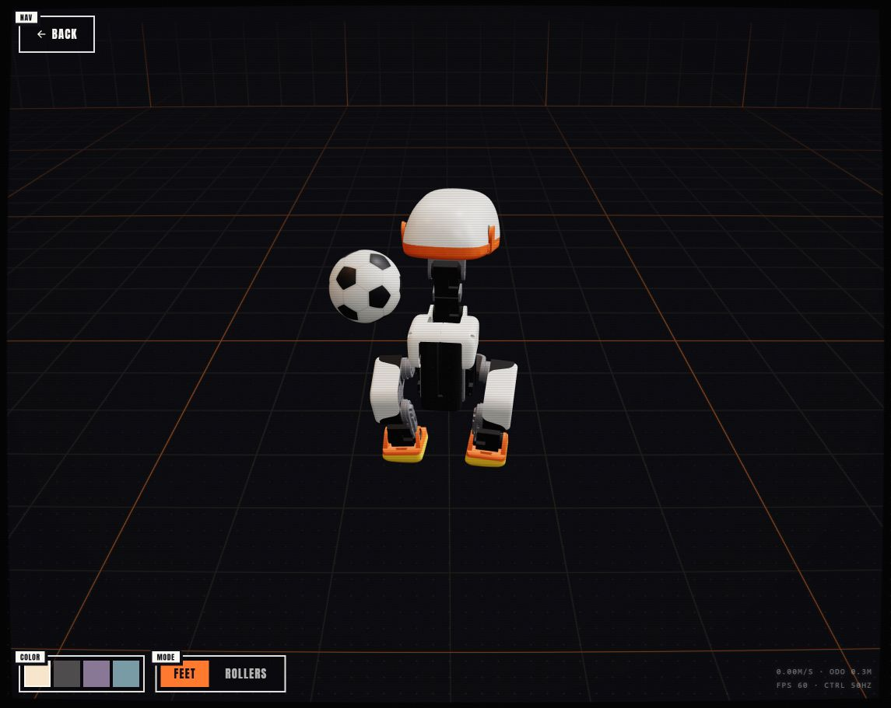

# MicroDuck Simulator

[中文](#中文) | [English](#english)



## 中文

### 项目简介

这是一个完全运行在浏览器中的 MicroDuck 机器人模拟器。项目使用 Three.js / React Three Fiber 渲染机器人与场景，通过 MuJoCo WebAssembly 进行实时物理仿真，并使用 ONNX Runtime Web 以 50 Hz 运行真实机器人的训练策略。

模型与模拟器逻辑来源于 Pollen Robotics 的 [MicroDuck Simulator](https://huggingface.co/spaces/pollen-robotics/microduck-simulator)。请遵守上游项目和模型资源的许可条款。

### 功能

- 完整 MicroDuck 模型、关节层级、碰撞体与场景资源
- 足式与轮式两种运动模式
- MuJoCo 实时物理仿真
- 本地 ONNX Runtime Web 推理，无需 CDN 即可启动核心模拟器
- 行走、坐立、翻滚、踢球、低头拾取和轮式下蹲策略
- 足式行走状态下的跌倒检测与自动起身策略
- 键盘、触摸屏和游戏手柄控制
- 多种机器人配色与动态相机
- 通过 Web Serial 读取 Feetech 总线舵机位置并映射到模拟器，也可在人工启用和限幅保护下输出模拟器关节目标

### 实物舵机串口调试

在桌面版 Chrome 或 Edge 中通过 `http://127.0.0.1:5173/` 打开模拟器并进入场景，点击右上角 `SERVO DEBUG`：

1. 将 USB 转串口适配器连接到舵机总线，并选择对应串口。
2. 默认波特率为 1 Mbps；波特率和轮询频率均可按硬件配置调整。
3. 每个关节的舵机 ID 都可独立编辑为 0–253 的整数，清空则取消该关节映射。默认 ID 1–14 按策略关节顺序排列、ID 15 对应下颚，仅作初始映射；请按实物接线核对，可配置反向和零位偏移。
4. 串口连接后默认只读取位置，模拟器仍可正常运行与执行动作。需要把实测姿态显示到模拟器时，再点击 `FOLLOW REAL JOINTS IN SIM`；该模式会暂停 AI 与物理步进，仅在 3D 关节显示层叠加实测角度，不修改 MuJoCo 物理状态。停止跟随后恢复模拟器控制。

位置读取默认使用地址 56，角度换算使用位置值低 12 位（0–4095，中心 2048）；如果设备返回超出单圈的 16 位计数，会按单圈位置回绕换算。模型显示会遵守各关节的 MJCF 角度范围（`head_yaw` 为 ±170°），超限读数会限幅。

需要向实物输出时，在 `legs` 或 `rollers` 模式下停止 `FOLLOW REAL JOINTS IN SIM`（该跟随功能只支持 legs），然后按 `ENABLE SIM → SERVO OUTPUT` 并确认警告。连接串口不会自动发送命令。输出使用当前活动模拟模型中同名关节的角度，通过 Feetech 同步写指令写入 Goal Position 地址 42；仅当本轮读取到有效位置的非广播 ID 1–253 舵机会纳入写入。`rollers` 模型中的被动轮子转角不是映射关节，不会作为舵机目标发送。多个关节可共用同一个舵机 ID；该 ID 每轮只输出一次，由关节列表中首次出现的映射决定目标角度和限幅。输出频率可选 1、2、5、10、20、30、40 或 50 Hz；同步写可减少多舵机写入的串口开销，但串口轮询和适配器处理能力可能使实际频率低于设定值，界面会显示软件侧实测发送频率。各关节的 `OUT MIN°` / `OUT MAX°` 默认值采用当前调试设置：左右 hip yaw −25°/+40°、hip roll −15°/+20°、hip pitch −150°/+69°、knee −90°/+100°、ankle −65°/+70°；neck pitch −150°/+65°、head pitch −85°/+85°、head yaw −140°/+140°、head roll −20°/+25°、jaw −10°/+10°。限幅以位置计数 2048 为中心，并结合该关节的反向和零位偏移换算。输出运行期间仍可修改 `OFFSET°`、`OUT MIN°` 和 `OUT MAX°`，修改会用于后续输出帧；舵机 ID 和方向在输出启用期间锁定。限幅只用于限制发送的目标角度，不要求实测当前位置在范围内；实测角度越界会提示，但不会拦截启用。启用仍要求每个有效舵机在线且有有效位置读数；短暂读数超时会暂停本轮输出并重试，连续 3 次读数失败才会锁止输出。输出状态显示最近发送的模拟角度、限幅目标角度和位置计数。开始前请核对总线协议/寄存器、舵机 ID、方向、零点及机械行程，并先将限幅保持在安全的小范围内。

`E-STOP · STOP + TORQUE OFF` 会立即锁止后续位置输出，然后向当前配置的每个有效单舵机 ID 发送 Torque Enable 地址 40、值 0 的指令以解除扭矩；地址 40 是 Feetech 控制表假设，使用前必须确认与 HD1910M1910 固件兼容。界面会报告发送失败和跳过的广播/无效 ID，但不会读回或确认舵机实际扭矩状态。串口断开、舵机故障或协议不兼容时，解除扭矩可能失败；这不是硬件断电急停。若实物有危险，请使用硬件断电/急停装置。输出采用 Goal Position 地址 42、位置地址 56、12 位单圈计数及中心 2048 的设备假设；请以 HD1910M1910 与适配器的官方资料确认兼容性。串口访问仅支持提供 Web Serial 的桌面浏览器及安全来源（例如 localhost）。

### AI 策略

模拟器包含 9 个 ONNX 策略文件：

| 策略 | 行为 |
| --- | --- |
| `BEST_alpha_walking.onnx` | 足式行走与转向 |
| `BEST_alpha_sitstand.onnx` | 坐下与站起 |
| `BEST_alpha_stand.onnx` | 跌倒后自动起身 |
| `roulade.onnx` | 翻滚动作 |
| `ball_kick_left.onnx` | 左脚踢球 |
| `ball_kick_right.onnx` | 右脚踢球 |
| `alpha_ground_pick.onnx` | 低头拾取动作 |
| `BEST_roller.onnx` | 轮式行驶 |
| `BEST_roller_crouch.onnx` | 轮式下蹲滑行 |

自动起身由跌倒检测状态机触发：机器人持续倾倒后会先短暂稳定物理状态，然后切换到 `BEST_alpha_stand.onnx`；保持直立一段时间后，控制权会自动交还给行走策略。如果起身失败，模拟器会安全重置机器人。

### 安装与运行

需要 Node.js 20 或更高版本。

```bash
npm install
npm run dev
```

打开终端显示的本地地址，通常是 `http://127.0.0.1:5173/`。

### 生产构建

```bash
npm run build
npm run preview
```

### 键盘操作

| 操作 | 按键 |
| --- | --- |
| 前后移动、转向 | 方向键或 `WASD` / `ZQSD` |
| 左脚 / 右脚踢球 | `Q` / `E` |
| 交替踢球 | `F` |
| 坐下 / 站起 | `R` |
| 低头拾取 | `G` |
| 切换追踪相机 | `C` |
| 切换足式 / 轮式 | `M` |
| 重置模拟器 | `Space` |

## English

### Overview

This is a complete MicroDuck robot simulator that runs in the browser. Three.js and React Three Fiber render the robot and arena, MuJoCo WebAssembly provides real-time physics, and ONNX Runtime Web executes the robot's trained policies at 50 Hz.

The model assets and simulator logic originate from Pollen Robotics' [MicroDuck Simulator](https://huggingface.co/spaces/pollen-robotics/microduck-simulator). Please follow the license terms of the upstream project and its assets.

### Features

- Complete MicroDuck model, joint hierarchy, collision geometry, and arena assets
- Legged and roller locomotion variants
- Real-time MuJoCo physics simulation
- Locally bundled ONNX Runtime Web with no CDN dependency for the core simulator
- Walking, sitting, rolling, kicking, ground-pick, and roller-crouch policies
- Fall detection and automatic recovery in legged walking mode
- Keyboard, touch, and gamepad controls
- Multiple color variants and a dynamic camera
- Feetech servo position polling over Web Serial with editable simulator joint mapping and manually armed, angle-limited simulator-to-servo output

### Physical Servo Serial Debugging

Open the simulator at `http://127.0.0.1:5173/` in desktop Chrome or Edge, enter the scene, and select `SERVO DEBUG` in the upper-right corner. Choose the USB serial adapter, then connect (default 1 Mbps). Each mapped joint's servo ID is freely editable as an integer from 0 to 253; clear an ID to leave the joint unmapped. The initial ID 1–14 policy-order mapping and ID 15 jaw mapping are only a starting point and must be checked against the robot wiring. Per-joint direction and zero offset are configurable, and the interface polls and displays every configured unique ID.

Connecting the serial port only reads positions; the simulator remains active by default. `FOLLOW REAL JOINTS IN SIM` can be enabled explicitly to pause AI and physics stepping and apply measured angles only to the rendered 3D joints; the MuJoCo physics state is left untouched. Stopping follow restores simulator control. Position reads use Feetech register address 56 and convert the low 12 bits (0–4095, center 2048); wider 16-bit counts wrap as single-turn positions. Rendered joints are clamped to their MJCF ranges (`head_yaw` is ±170°).

To command physical servos, stop `FOLLOW REAL JOINTS IN SIM` (leg mode only) and explicitly choose `ENABLE SIM → SERVO OUTPUT` in either `legs` or `rollers` mode, then confirm the warning. Connecting never enables writes automatically. Output uses same-named joint angles from the currently active simulator model and the Feetech Sync Write instruction at Goal Position address 42; only non-broadcast (ID 1–253) servos with valid position readings are included. Passive wheel rotation in the `rollers` model is not a mapped servo joint and is not sent. Multiple joints may share an ID; each servo receives one target per output cycle, controlled by the first matching joint in the list, including that joint's limits. Output frequency is selectable at 1, 2, 5, 10, 20, 30, 40, or 50 Hz. Sync Write reduces serial overhead for multi-servo updates, but bus polling and adapter performance may reduce the actual rate; the UI reports software-side measured transmit frequency. Sync Write is a broadcast frame and does not confirm per-servo receipt or execution. The default `OUT MIN°` / `OUT MAX°` values are the current tuned settings: left and right hip yaw −25°/+40°, hip roll −15°/+20°, hip pitch −150°/+69°, knee −90°/+100°, and ankle −65°/+70°; neck pitch −150°/+65°, head pitch −85°/+85°, head yaw −140°/+140°, head roll −20°/+25°, and jaw −10°/+10°. Limits are relative to position count 2048 and account for configured direction and zero offset. `OFFSET°`, `OUT MIN°`, and `OUT MAX°` remain editable while output is enabled and apply to subsequent output frames; servo IDs and direction remain locked while armed. These limits clamp commanded targets; the current physical position may be outside them and is only reported as a warning. Arming still requires every output-controlled servo to be online with a valid position reading; a missed read skips that output cycle and retries, while three consecutive missed reads lock output. Output status displays simulator angles, clamped target angles, and position counts for the most recent commands. Verify protocol/register compatibility, servo IDs, direction, zero calibration, and mechanical clearance before arming; confirm these broader default ranges are safe for your build before enabling output.

`E-STOP · STOP + TORQUE OFF` immediately locks out subsequent position commands, then sends Torque Enable address 40 with value 0 to each configured, valid individual servo ID to release torque. Address 40 is a Feetech control-table assumption and must be verified for the HD1910M1910 firmware before use. The UI reports send failures and skipped broadcast/invalid IDs, but does not read back or confirm the actual torque state. A disconnected bus, servo failure, or incompatible protocol can prevent torque release; this is not a hardware power-cut emergency stop. Use a hardware power cut/emergency stop if the robot is unsafe. Goal Position address 42, present-position address 56, 12-bit single-turn counts, and center 2048 are device assumptions that must be checked against the HD1910M1910 and adapter documentation. Web Serial requires a compatible desktop browser and a secure origin such as localhost.

### AI Policies

The simulator includes nine ONNX policy files:

| Policy | Behavior |
| --- | --- |
| `BEST_alpha_walking.onnx` | Legged walking and turning |
| `BEST_alpha_sitstand.onnx` | Sit and stand |
| `BEST_alpha_stand.onnx` | Automatic fall recovery |
| `roulade.onnx` | Rolling action |
| `ball_kick_left.onnx` | Left kick |
| `ball_kick_right.onnx` | Right kick |
| `alpha_ground_pick.onnx` | Ground-pick action |
| `BEST_roller.onnx` | Roller locomotion |
| `BEST_roller_crouch.onnx` | Roller crouch and glide |

Automatic recovery is controlled by a fall-detection state machine. After a sustained fall, the simulator briefly settles the physics state and switches to `BEST_alpha_stand.onnx`. Once the robot remains upright, control returns to the walking policy. A failed recovery safely resets the simulation.

### Install and Run

Node.js 20 or later is required.

```bash
npm install
npm run dev
```

Open the local URL shown in the terminal, usually `http://127.0.0.1:5173/`.

### Production Build

```bash
npm run build
npm run preview
```

### Keyboard Controls

| Action | Key |
| --- | --- |
| Move and turn | Arrow keys or `WASD` / `ZQSD` |
| Left / right kick | `Q` / `E` |
| Alternate kick | `F` |
| Sit / stand | `R` |
| Ground pick | `G` |
| Toggle chase camera | `C` |
| Toggle legs / rollers | `M` |
| Reset simulation | `Space` |
